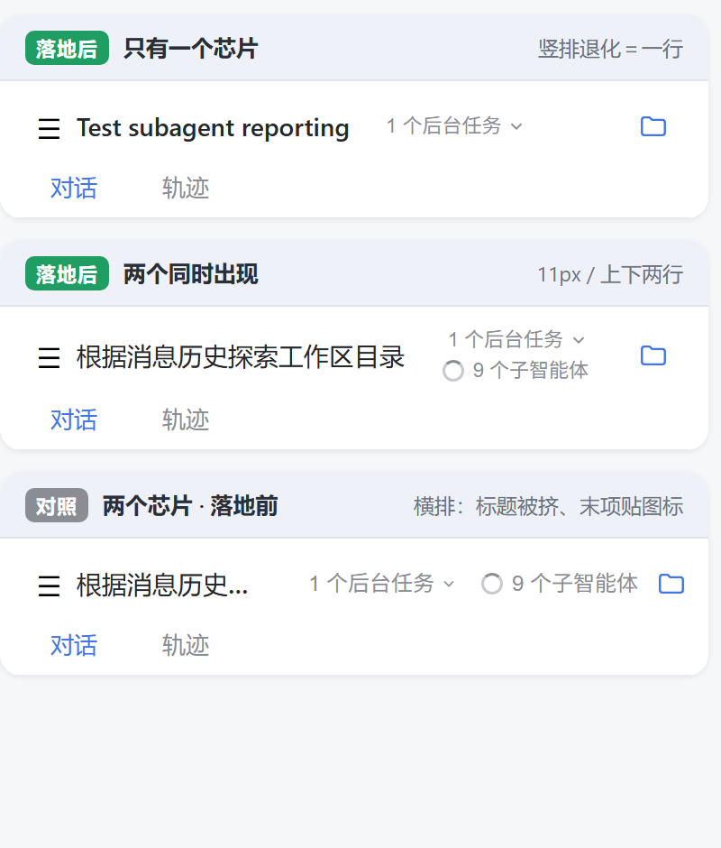
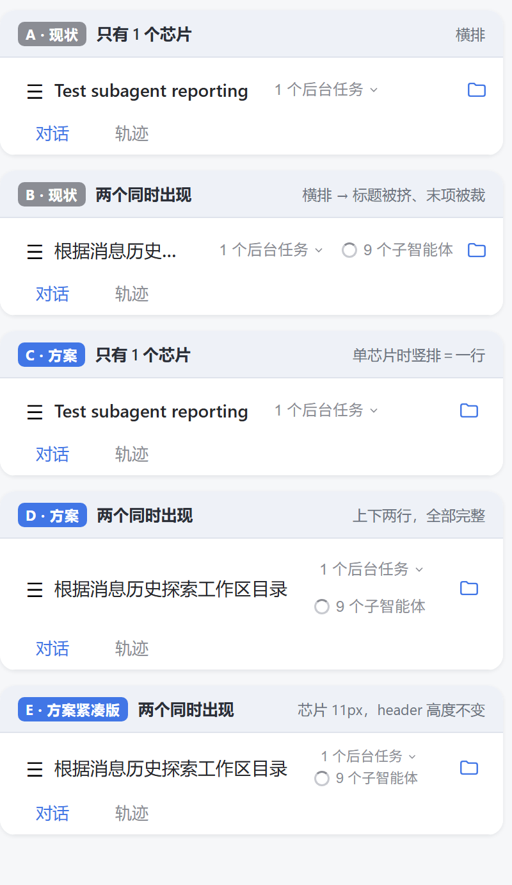

# 会话页顶栏芯片布局方案（上下堆叠）

- 日期：2026-10-23
- 状态：**E 档已落地代码**（`compat.js` `kxxy-webview-compat@11`），打包待复核（见第 10 节）
- 涉及文件：`plugins/kxxy-host/web/compat.js`、`tools/test-compat-css.mjs`、`tools/smoke-plugin.mjs`、`android/app/src/main/java/app/kxxy/engine/RuntimeInstaller.kt`、`tools/simulate-install.mjs`、`README.md`（缺陷 DV 行）

---

## 1. 背景与诉求

用户在真机上反馈：`@container` 垫片修好之后，「标准模式」不再压字（已生效），但**会话页顶栏右侧的两个状态芯片仍把标题挤成一两个词**。

用户明确提出的目标：

> 把后台任务和子智能体的布局改成，如果只有一个就完全显示，如果两个同时出现，你就上下显示。

所以目标不是「再调小一号字体」，而是**让芯片在双芯片时改为纵向堆叠**，把横向空间让回给标题。

---

## 2. 现状问题

顶栏结构（`393dp` 视口）：

```
┌────────────────────────────────────────────────┐
│ ☰  根据消息历史探索工作区目录   1 个后台任务 ⌄  ○ 9 个子智能体  📁 │
│    对话   轨迹                                                  │
└────────────────────────────────────────────────┘
```

- 标题可用宽度只有约 **120px**，被压成「根据消息历史…」甚至只剩两三个字。
- 两个芯片 + 右上角侧栏入口图标合计约 **150px**，在 `393dp` 里拿走了 38% 的横向空间。
- 三芯片时代（含「标准模式」）是「互相压字」；两芯片时代是「标题被挤扁」。同一根因的两种表现。

---

## 3. 根因（三层，逐层剥出来的）

### 3.1 第一层：没有「数量自适应」的布局手段

要在「只有一个芯片」和「两个芯片」之间切换排布，直觉做法是数一数子元素：

- `:has()` 数兄弟 —— **不可用**。项目目标 WebView 是 Chrome 104，`:has()` 不存在，靠 `compat.js` 的 `hasRewriteCss` 改写兜底；改写在 `_headerActions` 这种高特异性（+`!important`）场景下容易惰性化，等于把布局稳定性押在一个文本改写器上。
- JS 量数量再切类 —— 要监听窗口尺寸、首帧会跳变、多一处状态。

### 3.2 第二层：上游把 `headerActions` 做成了横向滚动盒

`dsh-web-mobile@3.1.0` 手机档规则（内嵌在 `plugins` 里那份 `client.js`）：

```css
[data-mobile-nav="frame"] [data-phase] header [class*="_headerActions"] {
  flex: 0 1 auto;
  min-width: 0;
  max-width: calc(100% - 32px);
  margin-left: auto;
  justify-content: flex-start;
  gap: 4px !important;
  overflow-x: auto !important;      /* ← 关键 */
  overflow-y: hidden;
}
```

`overflow-x: auto` 意味着这个盒子**本来就是「装不下就横着滚」的设计**。一旦把主轴换成 `column`，`overflow-x` 会自动提升为纵向裁剪（CSS 规范：一个轴为 `visible`、另一个不为 `visible` 时，`visible` 会被计算为 `auto`），结果两行被裁掉、还多出一条看不见的滚动缝。

### 3.3 第三层：上游还有一条高特异性 `flex-direction: row` 兜底

同一份样式里有一条给「0.1.6 那一代宿主」用的旧规则：

```
header:has([class*="_headerLeading"]) [class*="_headerActions"] {...}
```

它的选择器由 **4 个属性选择器**叠加，并且带 `!important`。`compat.js` 若只写 `header [class*="_headerActions"]`（特异性 0-1-1），会被它压回去。

---

## 4. 方案核心：不判断数量，改主轴方向

**结论：`flex-direction: column` 本身就是数量自适应的。**

| 芯片数 | `row`（现状） | `column`（方案） |
| --- | --- | --- |
| 1 个 | 一行，占宽度 ≈ 100px | 一列，视觉上仍是**一行**，宽度相同 |
| 2 个 | 一行，占宽度 ≈ 150px | **两行**，宽度 ≈ 80px |

单芯片时 `column` 与 `row` 的渲染结果**像素级一致**（只有一个子元素，主轴方向不改变它的位置），双芯片时自动变成上下两行。因此不需要任何数量判断、不需要 `:has()`、不需要 JS。

横向空间账（`393dp`）：

- 现状双芯片：标题 ≈ 120px
- 方案双芯片：芯片列宽由最宽的「1 个后台任务 ⌄」决定 ≈ 84px ⇒ 标题 ≈ **186px**，多出 66px（+55%）

---

## 5. 尺寸档位：D 还是 E

| 档位 | 芯片字号/行高 | 热区高 | 两行合计 | header 高度（76 起） | 观感 |
| --- | --- | --- | --- | --- | --- |
| 保持现状（对照） | 12px / 18px | 28px | 56px | 76 → **97**（+21） | 两行明显偏高，顶栏变“厚” |
| **D** | 12px / 18px | 28px | 56px | 76 → 97 | 保持原字号，但顶栏增高 21px |
| **E（采用）** | **11px / 15px** | **17px** | **34px** | 76 → **87（+11）** | 两行紧凑，顶栏几乎不变高 |

E 档被采纳的理由：

1. 顶栏高度只涨 11px，和下方 tabs 的留白能吃掉，不破坏 `min-height: 76px` 的栅格节奏。
2. 11px 是项目移动档既有下限（`dsh-web-mobile` 自己也把状态行压到 10–11px），不引入新字号档。
3. 两行之间的视觉间距由 `line-height: 15px` 与 `gap: 0` 共同决定，实际观感是「贴在标题右侧的一列小标签」，不抢焦点。

热区补偿：`min-height: 17px` 偏小，若真机点按困难，把它改成 `22px` 即可（两行合计 44px，header 87 → 97，退回 D 档高度）。

---

## 6. 最终实现（`compat.js` 的 `MOBILE_LAYOUT_CSS`，540px 块）

```css
@media (max-width: 540px) {
  /* ① 主轴换成纵列 —— 三件事必须一起给 */
  header [class*="_headerActions"]:not(#kxxy) {
    flex-direction: column !important;
    align-items: flex-end !important;   /* 右对齐，与横排时靠右的视觉一致 */
    justify-content: center !important; /* 两行整体在 titleRow 里垂直居中 */
    gap: 0 !important;                  /* 竖向间距交给两边的 line-height */
    overflow: visible !important;       /* 压掉上游 overflow-x: auto */
    max-width: none !important;         /* 压掉 calc(100% - 32px) */
  }

  /* ② 单行紧凑尺寸（E 档） */
  header [class*="_headerActions"] > *:not(#kxxy) {
    min-width: 0;
    min-height: 17px !important;
    padding-block: 0 !important;
    font-size: 11px !important;
    line-height: 15px !important;
  }

  /* ③ 芯片内部文字自己带 font-size，只改根元素管不到它们。
        排除 svg —— 圆环图标被 line-height 拉变形 */
  header [class*="_headerActions"] > *:not(#kxxy) > *:not(svg) {
    font-size: inherit !important;
    line-height: inherit !important;
  }

  /* ④ 图标收到 11px 与文字同高 */
  header [class*="_headerActions"] svg {
    width: 11px !important;
    height: 11px !important;
  }

  /* ⑤ 右上角侧栏入口的负边距原本是 -16px，竖排后会把图标压到芯片列上 */
  header [class*="_headerCorner"]:not(#kxxy) {
    margin-left: 2px !important;
    margin-right: -6px !important;
  }

  /* ⑥ 标准模式的 label 隐藏规则（缺陷 DT） */
  header [class*="_label"]:not(#kxxy) { display: none !important }

  /* ⑦ 恢复 headerActions 内的 label（否则子智能体文字会一起消失，见第 7 节） */
  header [class*="_headerActions"] [class*="_label"]:not(#kxxy) { display: revert !important }
}
```

### 6.1 为什么选择器都带 `:not(#kxxy)`

`:not(#kxxy)` 把特异性抬到 **(1,1,1)**，用于压过上游那组「4 个属性选择器 + `!important`」的旧规则；同时它是**恒真**的（页面里不会有 `id="kxxy"` 的元素），既不依赖宿主是否带 `data-mobile-nav`、也不额外增加属性选择器。

缺了它，本层特异性只有 (0,1,1) —— 同为 `!important` 时按特异性比较，会被上游压掉。这个坑在预览里真实踩到过一次（对照组忘了带 `:not(#kxxy)`，面板没变回横排）。

### 6.2 为什么顺序不写死

上游把后台任务 chip 用 `order: 9` 推到末位（`.QsffPG_root`），agent-team 的 TeamAction 挂 `order: 20`。`flex-direction: column` 不改变 `order` 的语义，所以纵向两行的顺序自动与横向一致：**子智能体在上、后台任务在下**。写死 `order` 反而会在上游调整顺序后错位。

---

## 7. 顺手修掉的一处回归（`@10` 引入）

落地竖排之后，预览里子智能体芯片**只剩一个圆环、「9 个子智能体」六个字不见了**。

原因：`@10` 那条隐藏标准模式的规则按 `_label` **后缀**锚：

```css
header [class*="_label"]:not(#kxxy) { display: none !important }
```

上游各插件的 label 类名共用 `_label` 后缀：

- `.f8BMvq_label` —— 标准模式（该藏）
- `._3K3mEa_label` —— 子智能体（不该藏）

一条规则分不开它们。`@10` 注释里写的「误伤面可控，header 里带 `_label` 的多是按钮内文字」这个判断是**错的**，已改写。

修法：紧跟一条恢复规则（第 6 节 ⑦），只恢复 `headerActions` 内的 label：

```css
header [class*="_headerActions"] [class*="_label"]:not(#kxxy) { display: revert !important }
```

能这样切是因为**结构差别是稳的**：

- 标准模式的 label 挂在 `titleRow` 那一层（**不在** `headerActions` 内）
- 两个状态芯片是 `headerActions` 的直接子级

用 `revert` 而不是 `inline`：label 可能是块级容器，`inline` 会改变盒模型。

---

## 8. 渲染对照

### 8.1 落地后 vs 落地前（三面板）



- **面板一（落地后，单芯片）**：只有「1 个后台任务」，竖排退化为一列 = 一行，与横排像素级一致。
- **面板二（落地后，双芯片）**：两行 11px，「9 个子智能体」在上、「1 个后台任务」在下，标题「根据消息历史探索工作区目录」**完整显示**。
- **面板三（对照，落地前）**：横排，标题被截成「根据消息历史…」，末项贴住右上角图标。

### 8.2 D / E 档位对比（五面板）



---

## 9. 验证

### 9.1 单测

`node tools/test-compat-css.mjs` → **74 通过 / 0 失败**。`[8]` 段新增 7 条断言：

1. 竖排规则存在（`flex-direction: column` 且带 `!important`）
2. 特异性提升（`:not(#kxxy)` 正则命中）
3. `overflow: visible` 覆盖上游 `overflow-x: auto`
4. 紧凑尺寸（`11px` / `17px` / `line-height: 15px`）
5. 内部文字继承规则存在且排除 `svg`
6. corner 负边距改为 `-6px`
7. `_label` 恢复规则存在，且同样带 `:not(#kxxy)`

### 9.2 冒烟

`node tools/smoke-plugin.mjs` 全绿（含「`compat.js` 首行标记 ⇄ `RuntimeInstaller.COMPAT_LAYER_MARKER` 必须一致」的自动校验，覆盖 `@11` 同步）。

### 9.3 可视化验证手法（可复用）

`.cache/preview/gen-css.mjs` 用正则从 `compat.js` 抽出 `MOBILE_LAYOUT_CSS` 的字符串数组、拼成**真实的** CSS 落地文件，再用无头 Chrome 按 393dp 渲染：

```
chrome --headless --disable-gpu --no-sandbox --hide-scrollbars \
  --force-device-scale-factor=2 --screenshot=out.png --window-size=400,470 \
  file:///C:/KF/DSH%20KXXY/.cache/preview/preview-live.html
```

两个注意点：

- 无头 Chrome 里 `window.innerWidth` 读到 **0**，不能靠页内 JS 测宽，尺寸只能靠 `--window-size`。
- 对照组的覆盖规则也必须带 `:not(#kxxy)`，否则压不过本层（第一版就栽在这）。

---

## 10. 风险、回退、待办

### 10.1 风险

| 风险 | 影响 | 处置 |
| --- | --- | --- |
| 上游改 `headerActions` 的类名片段 | 竖排失效，退回横排（不崩） | 选择器用的是片段 `[class*="_headerActions"]`，上游改哈希前缀不影响 |
| 上游改 `order` | 上下顺序变化 | 不写死 `order`，跟随上游 |
| 热区 17px 偏小 | 点按不中 | 改 `min-height: 22px`（退回 D 档高度 97px） |
| 双芯片时顶栏高 87px | 首屏内容下移 11px | 与 tabs 留白可抵消；不接受则把 `line-height` 压到 14px |

### 10.2 回退

删掉第 6 节 ①–⑤ 五条规则（保留 ⑥⑦），重跑 `build-runtime` 即恢复横排。

### 10.3 待办（2026-10-23 晚间已全部完成）

- [x] **`ext-pool` 目录丢失**：`fetch-extensions.mjs` 从 `.cache/debs`（373 个 deb 缓存，1.0 GiB）增量重打，26 项全部重建（1.16 GiB）；重打期间上游 `php` 升到 8.5.12，导致 `extensions.json` 与 runtime.zip 内嵌目录出现 8 项实质差异 ⇒ 连带重打了 runtime.zip（新指纹 `kxxy-host@a925099f7c34`）。
- [x] **完整 APK 已打出**：`app-signed.apk` = `1,993,601,284 B`（1.99 GB），26 池 + `runtime.zip` + `alias-links.txt` 全部注入。
- [x] 核对通过：`versionCode='1032'` / `versionName='0.9.3+4.861b995'`（提交 `861b995` 后重打，无 dirty 后缀）；APK 内 `assets/runtime.zip` sha256 与 `build.json` 逐字一致；包内 `compat.js` 首行 `/* kxxy-webview-compat@11 */`；`apksigner verify` 签名有效。
- [x] 提交 `861b995` 并推送到 GitHub（`d83475f..861b995 main -> main`）。

---

## 11. 变更清单

| 文件 | 改动 |
| --- | --- |
| `plugins/kxxy-host/web/compat.js` | `MOBILE_LAYOUT_CSS` 540px 块新增 5 条竖排规则 + 1 条 label 恢复规则；版本标记 `@10 → @11` |
| `tools/test-compat-css.mjs` | `[8]` 段新增 7 条断言（74 通过 / 0 失败） |
| `tools/smoke-plugin.mjs` | 断言链已覆盖标记一致性，无需改动 |
| `android/app/src/main/java/app/kxxy/engine/RuntimeInstaller.kt` | `COMPAT_LAYER_MARKER` 同步为 `@11` |
| `tools/simulate-install.mjs` | 同上 |
| `README.md` | 缺陷表新增 **DV** 行 |
