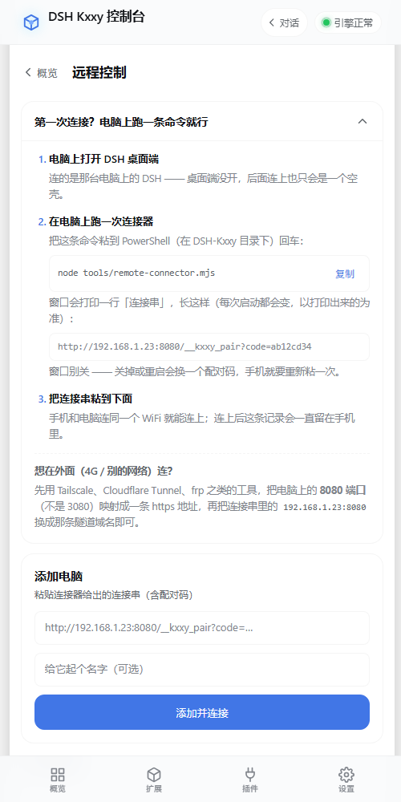

# 手机控电脑：Kxxy 连接 DSH 桌面端

> 版本：v0.9.13（补丁集 `@12`）
> 方向：**A 向 —— 手机上操作电脑上的 DSH**。不是「电脑看手机」，也不是会话级对等。

## 一、为什么这么做

DSH 的前端是**服务端下发**的：浏览器打开一个 URL 就是完整客户端，不需要在手机上装第二套 UI。所以「手机控电脑」在技术上不需要做客户端移植，只需要解决一件事——**手机怎么安全地打开电脑上的那个 URL**。

问题在于电脑端的默认姿态：

| 现状 | 后果 |
|---|---|
| 只监听 `127.0.0.1` | 局域网内直接访问不到 |
| Host 校验只认回环 + 显式 `trustedHosts` | 即使能连，也会被 403 拒掉 |
| `--host 0.0.0.0` 被源码主动拒绝 | 上游明确不支持「绑所有网卡」 |

我们**不去改它**（官方 Electron 包的 asar 改不了，改了会被下次更新覆盖），而是在电脑上放一个几十 KB 的连接器做反代。

## 二、拓扑

```
┌────────────┐   局域网 / 隧道    ┌──────────────────┐   回环    ┌──────────────┐
│  Kxxy      │ ─────────────────► │ remote-connector │ ────────► │ DSH 桌面端    │
│  (WebView) │   http(s)://host   │  0.0.0.0:8080    │  Host 改  │ 127.0.0.1:3080│
└────────────┘                    └──────────────────┘  成回环    └──────────────┘
```

关键决定：**转发时把 `Host` 改回 `127.0.0.1:3080`**。上游于是认为请求来自本机，整套 origin / cookie 校验原样通过，一行都不用改它。

反过来做（保留原 Host + 让上游信任它）需要改上游的 `trustedHosts`，而桌面端的配置文件我们碰不到；且 cookie 签名绑定了 `host:port`，换 Host 就 401。

## 三、为什么不把引擎绑到局域网 IP

1. 绑定具体网卡地址后 `127.0.0.1` 不通 → 本机 WebView 白屏（`MainActivity` 硬编码加载回环）。
2. 手机换 WiFi、电脑换网段，IP 就变 → 每次都要重启引擎重绑。
3. 没有入口审计、限流、随时吊销的能力。

反代天然解决这三条：引擎始终只听回环，出口由连接器统一把控。

## 四、组件

### 原生侧（`android/.../remote/`）

| 文件 | 职责 |
|---|---|
| `RemoteLink.kt` | 连接串解析。三种形态（配对地址 / 引擎直连 / 隧道域名）统一成 `origin` + `url`；无 token/code 直接拒绝，避免用户面对英文 401 |
| `RemoteStore.kt` | 设备簿。按 origin 去重；`snapshotJson()` 给前端；凭据在快照里打码成 `token=••••••`（这份 JSON 会落盘，插件可读，不能有明文）。信任状态、失败计数、自动连候选的判定都在这里 |
| `RemoteBar.kt` | 远程会话顶部的设备条（50px）：设备名 + 通道/延迟 + 断开 |
| `QrScanActivity.kt` | 扫码页。CameraX 预览 + 逐帧分析；权限被拒时给「去设置 / 改用粘贴」两个出口 |
| `QrDecoder.kt` | 二维码解码（zxing core）。只取 Y 平面，按 `rowStride` 逐行搬运 |
| `NetFingerprint.kt` | 网络指纹（transport + 内网地址前三段）。零权限，不取 SSID |

`MainActivity` 新增 `kxxy://remote/<action>` 桥：`add` / `open` / `scan` / `trust` / `untrust` / `skiptip` / `remove` / `rename` / `connect` / `disconnect`。

### 前端（`kxxy-host/web`）

- 概览页新增「远程控制」卡：单设备时直接摊开（设备名 / 在线 / 延迟 / 连接），多设备时「管理」进列表。
- `#view-remote` 二级页：添加表单（连接串 + 备注）+ 已配对列表 + 「连接之后」说明。
- **没有底栏入口**：远程是从概览卡进出的二级页面，放进四宫格会让人以为它是第五个平级功能。`smoke-plugin.mjs` 里把它登记为「无页签视图」，数量断言随之放宽。

### 电脑侧（`tools/remote-connector.mjs`）

```
node remote-connector.mjs                 # 自动生成配对码
node remote-connector.mjs --code 7f3a9c21
node remote-connector.mjs --target "http://127.0.0.1:3080/?token=…"
```

启动后打印连接串，粘进 Kxxy「概览 → 远程控制 → 添加电脑」。

它做三件事：配对门、HTTP 反代（改 Host）、**WebSocket upgrade 透传**。

## 五、安全边界（四条，缺一条都不该发版）

1. **远程模式下 `kxxy://` 桥硬拒绝**。那套桥能申请系统权限、打开外部应用。远端页面是别人机器上的代码，绝不能碰本机原生能力。实现上 `remoteMode = true` 必须在 `loadUrl()` **之前**置位——反过来会有一个「页面已导航、标记还是 false」的窗口。
2. **只有已配对 origin 留在应用内**。其余 URL 一律交给系统浏览器，和本地模式同一条规则。
3. **SSL 错误只对已配对 host 放行**。自签证书的隧道才需要这一步；host 不在设备簿里就 `handler.cancel()`。
4. **配对 cookie 是 HttpOnly + SameSite=Lax**。局域网里谁都能扫到 8080，但没有配对码只能看到一张中文引导页。
5. **二维码里带配对码 —— 谁拍到谁能连**。这是扫码的固有代价（省掉手输就等于把凭证印在屏幕上）。不要把二维码截图发群；怀疑泄露就重启连接器换码，所有手机需要重扫。
6. **自动连只对「用户显式信任 + 成功连过」的设备生效**。信任不是添加时给的，而是一次真正加载成功之后才允许授予（见 `onPageFinished`）。否则扫到一条死链会被固化成「每次启动白等几秒」。

吊销方式要说清楚：手机端「删除设备」只是删本地记录（不再自动连），**真正的吊销是重启连接器换配对码**。

## 六、隧道

一期**不自研**隧道。用户已有的 Tailscale / Cloudflare Tunnel / frp 把**连接器端口（8080）**暴露出去即可，连接串把 host 换成隧道域名。中继带宽、证书、DNS 全部交给成熟工具，我们既不承担运维也不碰凭证。

注意是暴露 8080 而不是 3080。

## 七、验证

```bash
node tools/test-remote.mjs     # 107 项
```

分两段：契约段钉原生接线与安全边界（Kotlin 本地跑不起来）；真跑段起真 HTTP 服务验配对门、Host 改写、upgrade 透传、上游不可达时的 502 可读页。

真机自测顺序：

1. 电脑跑连接器 → 手机连同一 WiFi → **扫码** → 能进会话（不用粘连接串）。
2. 发一条消息看是否流式返回（这一步验的是 upgrade 透传）。
3. 断网 / 关连接器 → 手机端应显示可读错误，不是白屏。
4. 远程会话里点返回键 → 回到本机宿主页的「远程控制」，不是退出应用。
5. 回到远程页 → 出现「下次自动连」提示 → 点信任 → **杀掉 App 重开** → 应直接进入远程（顶部设备条在，点「断开」可退出）。
6. 再手动断开 → 10 分钟内重开 App **不应**自动连（冷却）；手动连一次后再断开，行为一致。
7. 换到 4G 或别的 WiFi → 局域网那台不自动连（网段指纹不匹配），隧道设备仍自动连。

## 八、已知边界

- **局域网 HTTP 是功能受限的**：非 secure context 下 `crypto.subtle` 不存在，DSH 的终端会拒绝工作；隧道走 HTTPS 则全功能。宿主自己的管理页不受影响（`host.js` 零处使用这些 API）。
- **cookie 绑 host:port**：连接器重启换端口，手机上要重新配对。
- **断点续连**：目前没有「网络切换自动重连」，WiFi ↔ 4G 切换需要手动重连（下一期）。
- **多设备同 token**：都算 owner，不会触发上游的只读限权——这是预期行为。

## 九、第一次连接速查（用户视角）

上面几节讲的是「为什么这么设计」。这一节只讲**手怎么动** —— v0.9.13 上线后
收到的第一个问题就是「我怎么连接我的电脑啊」，说明原来那段「粘贴连接串」
对没参与开发的人来说等于没说。步骤已同步写进手机端「远程控制」页顶部的引导卡。



### 电脑侧（只做一次）

1. 打开 **DSH 桌面端**（连接器只是把它转出来，它没开就无从连起）。
2. 在 `DSH-Kxxy` 目录下，二选一启动连接器：

   ```bat
   :: Windows：双击即可，窗口会自己停住不闪退
   tools\start-connector.cmd
   ```

   ```bash
   # 任意平台：手动跑
   node tools/remote-connector.mjs
   ```

3. 窗口里会打印四行关键信息，其中**连接串**是手机要用的那一条：

   ```
     Kxxy 远程连接器已启动
     上游        127.0.0.1:3080
     上游状态    ✓ 连得上
     配对码      a0ea9402

     连接串（粘到 Kxxy → 概览 → 远程控制 → 添加电脑）
       http://192.168.2.86:8080/__kxxy_pair?code=a0ea9402
   ```

   `上游状态` 这一行是 v0.9.14 新加的：它直接告诉你是「桌面端没开 / 端口不对」
   还是「一切就绪」，不用等手机端报 502 再回头查。端口不是 3080 时这样指定：

   ```bash
   node tools/remote-connector.mjs --target http://127.0.0.1:3000/
   ```

4. **窗口别关**。关掉或重启会换一个配对码，手机上就得重新粘一次。

### 手机侧

1. 手机和电脑连**同一个 WiFi**。
2. 打开 Kxxy → 概览 → 「远程控制」→ 添加电脑 → **扫码连接**，对着电脑上的二维码。
   扫不到（反光/暗光/距离太远）就点「或者粘贴连接串」那一段，整条粘进去一样能连。
3. 连上后设备条出现（设备名 + 通道 + 延迟 + 断开）。断开回本机后，页面上会出现
   「下次自动连」的提示，点**信任**即可免扫。

连上后顶部会出现一条设备条（设备名 + 通道 + 延迟 + 断开），远端页面整块落在
它下面。断开就回到本机宿主页的「远程控制」。

### 常见问题

| 现象 | 原因 | 处理 |
|---|---|---|
| 手机打不开，一直转圈 | 手机和电脑不在同一网段（常见：电脑走有线、手机走 4G） | 让两台设备进同一个 WiFi；或用隧道（第八节） |
| 打开是「连不上本机的 DSH」 | 桌面端没开，或端口不是 3080 | 打开桌面端；或用 `--target` 指对端口 |
| 打开是「需要配对码」 | 连接串只粘了 IP，丢了 `?code=` | 重新粘**整条**连接串 |
| 之前能连，今天不行 | 连接器重启后换了配对码 | 重新粘一次新连接串 |
| 能进会话，但终端一片空白 | 局域网是 http，非 secure context，`crypto.subtle` 不存在 | 走 https 隧道；或改用电脑上的终端 |


## 十、扫码与自动连接（v0.9.15）

### 为什么必须自己解二维码

连接串是 `http://192.168.1.23:8080/__kxxy_pair?code=…`。用系统相机扫，系统会把它当
**网址**交给浏览器：配对页确实能打开、cookie 也确实下发了，但那份会话在浏览器里，
本应用拿不到 —— 用户看到「能打开」却仍然连不上。所以扫码只能在应用内做。

链路只有一条：`QrScanActivity` 解码 → `RemoteLink.parse` 校验 → `RemoteStore.upsert`
→ `enterRemote`。和手粘连接串**完全同一条路**，`scan` 只是换了一种输入方式。

| 决策 | 选择 | 理由 |
|---|---|---|
| 解码库 | zxing core | 纯 JVM、约 600 KB、无 native、不依赖 GMS。我们只解自己生成的码（纠错 M、屏幕直出），ML Kit 的 3~5 MB 模型不值得 |
| 取哪个平面 | 只取 Y | 二维码是黑白图，亮度足够；省掉 YUV→RGB 是解码路径上最贵的一步 |
| 扫错码 | 不退出，换提示 + 静默 1.5 秒 | 用户会拿它扫快递单/付款码 |
| 权限被拒 | 「去设置」+「改用粘贴」 | 不给相机权限也不该连不上电脑，他的目的不是拍照 |

### 「保存方案」= 信任 + 网络指纹

设备簿本来就存了记录（按 origin 去重），v0.9.15 补的是**信任**这一层：

```
添加（origin 去重）
  └─ 连一次 → 真的加载出来（onPageFinished）→ 出现「下次自动连」提示
       └─ 信任 → trusted=true
            └─ 下次冷启动 → loadEngineUrl 里 autoCandidate() 命中 → 直接进入
                 （4.5s 内没加载出来 → 自动退回本机 + 一句「已回到本机」）
```

判定全在原生（`RemoteStore.autoCandidate`），页面只负责画。规则放两边会分叉，
而分叉后的症状是「有时候连、有时候不连」——用户没法自查。

**为什么判在 `loadEngineUrl` 而不是宿主页的 JS 里**：App 启动加载的是官方对话页
`/`，宿主管理页 `/kxxy` 要用户自己点进去才会加载。写在 JS 里的自动连接等于
「先打开控制台才会自动连」，与实际用法正好相反。这是实现时踩到的第一个坑 ——
界面上的按钮都做好了，功能却一次都不会触发。

退出自动会话仍然只有一条路：设备条上的「断开」（或双击返回）。用户的取消语义
等价于断开 —— 断开同时写 10 分钟冷却，不会被立刻连回去。

| 规则 | 值 | 为什么 |
|---|---|---|
| 授予时机 | 真正加载成功之后 | 扫到死链就授信 = 每次启动白等几秒 |
| 何时不自动连 | 手动断开后 10 分钟 | 用户点「断开」的意思是「现在不要」。没有冷却，退出远程会立刻被拽回去 |
| 何时降级为手动 | 连续失败 2 次 | 免得每次开 App 都先卡 4.5 秒 |
| 失败后重试 | 60 秒退避 | 失败会重载本机页，不设窗口就会「闪两下」 |
| 环境判定 | transport + 内网地址前三段 | 零权限。取 SSID 要 `ACCESS_FINE_LOCATION`，为一个自动连多要一个位置权限不值 |
| 隧道设备 | 不看指纹 | 在外网用 4G 连家里电脑是正常用法 |

**网络指纹的边界**：`192.168.1` 改成了 `192.168.0`（换了路由器）会判定为不同环境，
不会自动连 —— 手动连一次后就重新记住。这是刻意保守：宁可少连一次，也不要在
公司 WiFi 上自动连到家里那台。

### 已知缺口

- 二维码里带配对码，**谁拍到谁能连**。P3 计划加 `exp`（10 分钟有效），当前靠「换一个配对码」吊销。
- 自动连只在**冷启动**发生；从远程断开返回本地页不会立刻重连（就是上面那条冷却）。
- 断开的设备不会被「逐设备吊销」：配对 cookie 是整站一个，真正的吊销是换配对码。
