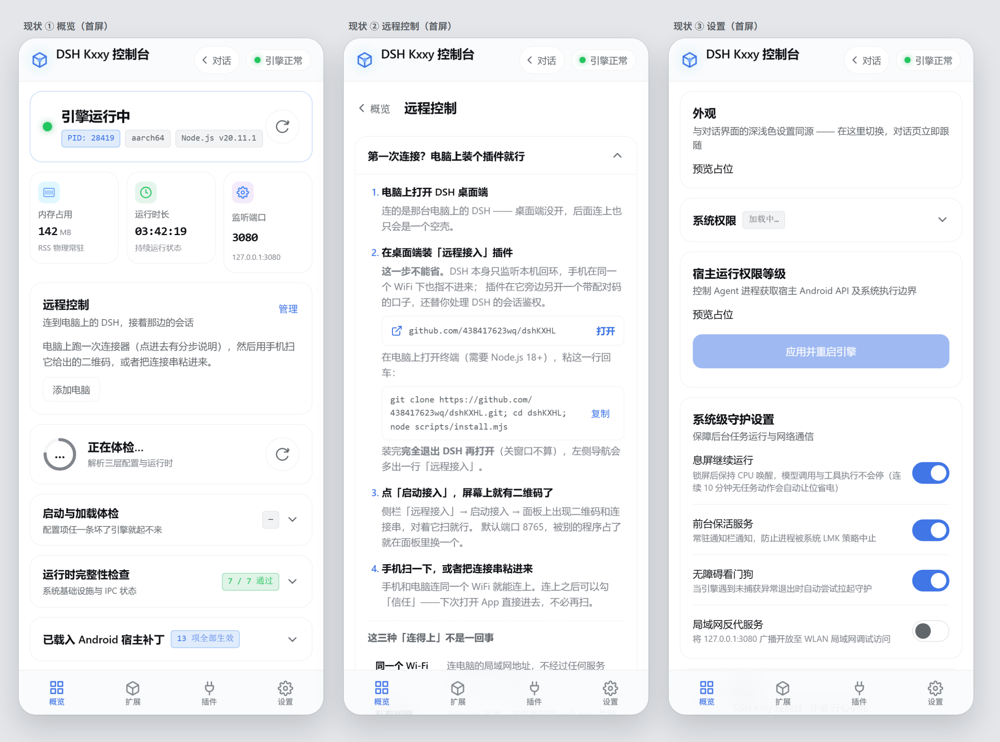
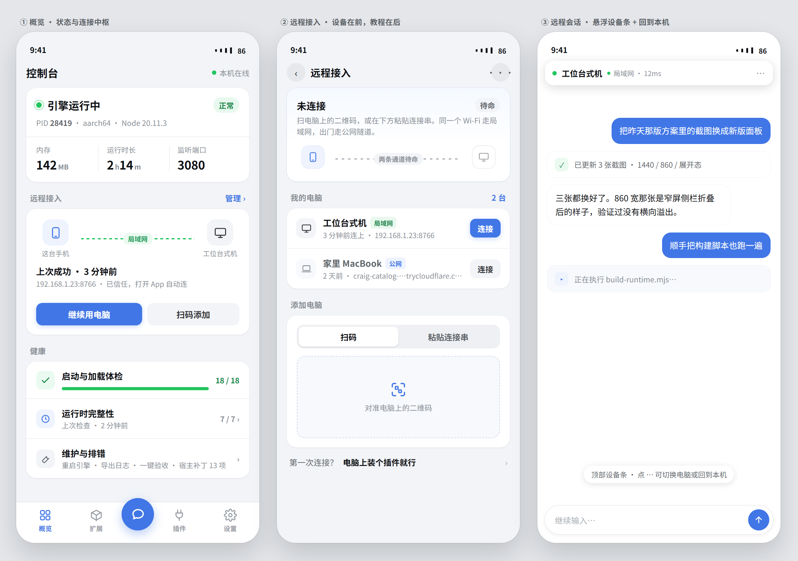

# 手机端界面改造方案（控制台 + 远程接入）

> 日期：2026-11-16 · 状态：**方案待评审**（未动代码）
> 范围：`plugins/kxxy-host/web/`（控制台前端，四个页签 + 远程接入二级页）、
> `android/.../remote/RemoteBar.kt`（远程会话设备条）
> 对照物：电脑侧 `dsh-remote-link` 面板已在 0.3.0 完成美化，本方案让手机端跟它同一套语言。

---

## 一、现状（无头 Edge，393×873，WebView 104 等价视口）



三屏都是真页面直出的静态骨架（数据是占位）。逐条说问题：

### 1. 视觉语言是「网页仪表盘」，不是「手机 App」

- 页面底色 `--bg-base` 与卡片 `--bg-layer-1` 在浅色主题下**都是 `#fff`**（`theme.css` 里
  `neutral-bluish-00`），层次只剩一圈 1px 边框。截图里卡片和背景几乎糊在一起。
- 每张卡都是「标题 15px + 副标题 12px」的同一个模板，卡片间距恒为 12px，
  一屏里出现 6 次同一节奏 → 页面又长又平。
- 底栏激活态只有图标变蓝，没有指示条；页签切换只有 `fadeIn`。

### 2. 首屏优先级是反的

概览页首屏从上到下是：引擎卡 → 三个指标 → 远程卡 → 体检 → 三个技术自检折叠。
其中：

- **日常最高频的动作（进对话界面）在页头右上角，是个 12px 的小胶囊**，权重低于旁边那个绿色状态点；
- 「启动与加载体检 / 运行时完整性 / 已载入 13 项宿主补丁」是**故障时才需要看**的东西，
  却占据了首屏以下的全部版面，而且三个折叠项各占一行、看不出区别。

### 3. 远程页是一篇教程，不是一台设备的入口


远程控制页首屏 90% 是「第一次连接？装载插件」的四步长文（含 git 命令、GitHub 链接、
三种网络方式对比表）。**已配对的设备列表被推到第三屏以下**，`添加电脑` 表单在第二屏。

也就是说：一个已经配对过三台电脑的老用户，每次进来都一样要滚过一遍教程才能点「连接」。

### 4. 「连接」这件事完全没有可视化

电脑侧面板有「手机 → 局域网/公网 → 电脑」的通道图 + 四指标；手机侧只有一行
「电脑上跑一次连接器…」和一个小按钮。原生侧其实**已经有数据**：

| 数据 | 来源 | 现在有没有画出来 |
|---|---|---|
| 通道类型（局域网 / 公网隧道） | `Device.kind` | 只在列表里画了一个 6px 圆点 |
| 上次成功时间 | `Device.lastOkAt` | 只有一句「上次成功 · X 前」的文字 |
| 是否信任 / 自动连 | `Device.trusted` | 一个「自动连」小开关，藏在卡里 |
| 失败连击 / 降级 | `Device.failStreak` | 完全没有 |
| 证书已固定 | `Device.certPinned` | 完全没有 |
| 延迟 | —— | **原生没有这个字段**，见 §五 的 P2 说明 |

### 5. 细节

- `127.0.0.1:3080`、`RSS 物理常驻` 这类 `metric-foot` 只有 **10px** 且被 `ellipsis` 截断，真机上等于看不清；
- 三指标卡在 393dp 下每列约 113dp，「监听端口」那格的地址被压到贴边；
- 主按钮用的是 `--accent-blue`（`#4176e6`），「管理 / 打开」这类链接也是同一个蓝，
  一屏里三个同权重的蓝，主次不分；
- 深浅色两套 token 是齐的，但浅色下因为卡片与底色同白，「浅色主题」看起来像低对比度的灰稿。

---

## 二、改造稿



（可编辑源：`mockups/2026-11-16-手机端-改造稿.html`，改完直接无头截图即可复现）

### 屏 ① 概览：一屏回答「现在好不好 + 我要去哪」

| 改动 | 为什么 |
|---|---|
| 引擎卡改为**单块状态条**：绿点 + 「引擎运行中」+ 右侧「正常」徽章，下面一行元信息，再下面一行三格（内存 / 运行时长 / 监听端口），用竖分割线而不是三张卡 | 三张卡在 393dp 下已有压边风险；合并后省 44dp 高度，且数值从 20px 提到 19px 加粗反而更清楚 |
| 页头只留「控制台」+ 一个「本机在线」小状态，去掉「对话」胶囊 | 「对话」提到**底栏中央的圆形主按钮**（见下） |
| 底栏改为 4 页签 + **中央悬浮「对话」按钮** | 这是全 App 最高频的动作，现在被塞在页头角落。远程二级页**不进底栏**（尊重 2026-11-06 的结论），但「回到对话」必须常驻 |
| 远程卡 = 通道图（手机 ══ 局域网 ══ 电脑）+ 一行「上次成功 · 3 分钟前 / 地址 / 自动连已开」+ 主次两个按钮 | 把「连接」这件事画出来；用户一眼知道走的是哪条通道、上次成不成 |
| 体检从「圆环 + 大字」改为**列表行 + 比例**（18/18），运行时检查并入同一组 | 圆环占 88dp 只表达一个布尔值；列表行能同时带「上次检查时间」和入口 |
| 三个技术自检折叠 → 合并为一行「维护与排错 ›」（点进二级页） | 概览不该有第三个折叠区；宿主补丁清单只在排障时有意义 |
| 新增分组标题（12.5px / 600 / `#8a8f96`），卡片之间用 10px 白隙 + 分组标题 16px 呼吸 | 这是 iOS 分组列表的节奏：**卡外有标题，卡内不重复标题**，信息分组靠留白而不是靠边框 |

### 屏 ② 远程接入：设备在前，教程在后

| 改动 | 为什么 |
|---|---|
| 顶部加**状态卡**：未连接时是「未连接 / 待命」+ 一句方法说明 + 灰通道图；已连接时是浅蓝渐变卡 + 绿点 + 延迟 + 断开 | 用户进来第一个问题是「我现在连着没有」。现在这个问题没有任何地方回答 |
| 「我的电脑」列表上移到第一屏，每行：机器图标 / 名称 / 通道 chip（局域网=绿、公网=蓝）/ 上次成功时间 / 地址 / 右侧「连接」 | 老用户 0 次滚动就能连上 |
| 离线的设备整行降透明度，chip 变灰，按钮变次级 | 光看名字分不出哪台能连 |
| 「添加电脑」改为 **segmented（扫码 / 粘贴连接串）**，扫码是默认页，给一块 132dp 的扫码引导框 | 现在扫码按钮和粘贴输入框平铺堆在一起，两个入口互相稀释 |
| 四步教程收进底部一行折叠「第一次连接？**电脑上装个插件就行** ›」，只有**零设备**时默认展开 | 教程本身写得好，是位置错了。零设备 = 新用户，展开；有设备 = 老用户，收起 |

### 屏 ③ 远程会话：设备条从「一条横幅」变成「一颗胶囊」

现在的 `RemoteBar` 是 50dp 高的通栏条，把远端页面整个往下推 50dp，且只有
「设备名 / 通道 · host」和「断开」两个信息。改造为：

- **30dp 悬浮胶囊**，左右各 12dp 内缩、圆角 14、带投影，浮在远端页面之上（不给 WebView 让位，
  改为 `paddingTop` 让位 46dp 或干脆覆盖在第一行标题之上——见 §五 的实现说明）；
- 内容：绿点 + 设备名 + 「局域网 · 12ms」+ 右侧 `⋯`；
- 点 `⋯` 弹出底部 sheet：切换电脑 / 重连 / 回到本机（本机 = 原来的「断开」）；
- 返回键语义不变（第一次按提示、第二次断）。

**理由**：远端页面是官方前端，我们只能叠一层。通栏条会把官方顶栏永久顶掉一段，
而胶囊只在左上角占一小块，视觉上更像「系统级提示」，也不破坏远端布局。

---

## 三、设计规范（可直接落进 host.css）

### 3.1 Token 修正

```css
/* 关键：浅色下三层背景全是 #fff，必须自己造一层「页面底」 */
body {
  --kxxy-page:  #f2f4f7;                              /* 页面底色（新增，比卡面深一档） */
  --kxxy-card:  var(--dsw-alias-bg-base, #fff);       /* 卡面 */
  --kxxy-inset: #f7f9fc;                              /* 卡内次级块（扫码框/代码块） */
  --kxxy-line:  rgba(15, 17, 21, .07);                /* 分隔线（替代 1px 边框） */
  --kxxy-t1:    var(--dsw-alias-label-primary, #0f1115);
  --kxxy-t2:    var(--dsw-alias-label-secondary, #61666b);
  --kxxy-t3:    var(--dsw-alias-label-tertiary, #8a8f96);
  --kxxy-accent: var(--dsw-alias-link, #4176e6);      /* 主色：只给主按钮 + 链接 */
  --kxxy-ok:    var(--dsw-alias-state-success-primary, #22c55e);
  --kxxy-warn:  var(--dsw-alias-state-warn-primary, #f59e0b);
  --kxxy-off:   #adb2b8;
}
body[data-ds-dark-theme] {
  --kxxy-page:  #0f0f10;
  --kxxy-inset: #232324;
  --kxxy-line:  rgba(255, 255, 255, .08);
  --kxxy-t3:    #979da6;
  --kxxy-off:   #61666b;
}
```

> ⚠️ 沿用现有约定：映射必须挂 `body`（不能挂 `:root`），否则 `--dsw-*` 在解析期取不到。
> 这条在 host.css 顶部已有注释记录，别改回去。

### 3.2 字阶（手机端只有 6 级，多一级都不要）

| 用途 | 字号 / 字重 | 颜色 |
|---|---|---|
| 屏标题（控制台 / 远程接入） | 17 / 650 | t1 |
| 卡内主标题、列表行标题 | 14–15 / 600 | t1 |
| 关键数值 | 19–22 / 650，单位 11 / 600 | t1 |
| 正文 | 13.5 / 400，行高 1.6 | t1 |
| 辅助说明 | 12 / 400 | t2 |
| 元信息、分组标题、chip | 11.5–12.5 / 600 | t3 |

**删除所有 9–10px 的文本**（`metric-foot`、`remote-meta` 里的地址），最小 11.5px。

### 3.3 尺寸与节奏

- 页面左右边距 16dp；卡片圆角 16、内边距 15/16；
- 分组标题上下 `16 / 8`；卡片之间 10dp；
- 列表行最小高 52dp，图标块 30–32dp、圆角 9–10；
- 按钮：主 44dp（块级）/ 36dp（行内）/ 30dp（紧凑），圆角 10–12；
- 触摸目标一律 ≥ 44dp（含 padding 命中区）。

### 3.4 动效（只有三条，别加）

1. **通道流动**：SVG `stroke-dashoffset` 4s 线性循环，只在「已连接」状态跑（`prefers-reduced-motion` 时停）；
2. **状态点呼吸**：`box-shadow` 扩散 2s，只在「运行中/在线」时跑；
3. **页签切换**：内容 `translateY(6px) → 0` + `opacity` 180ms，替代现在的纯 fadeIn。

### 3.5 双通道配色（全 App 统一）

| 通道 | 颜色 | 用在哪 |
|---|---|---|
| 局域网 | 绿 `#22c55e` | chip、通道虚线、状态点 |
| 公网隧道 | 蓝 `#4176e6` | chip、通道虚线（虚线更慢一格，暗示路径更长） |
| 未连接 / 离线 | 灰 `#adb2b8` | 虚线、chip、整行降透明 |

---

## 四、技术约束（真机 WebView 104，必须遵守）

`com.google.android.webview 104.0.5112.97`，切不了 provider。以下特性**不能用**：

| 特性 | 最低版本 | 替代方案 |
|---|---|---|
| `:has()` | 105 | 加类名（host.js 渲染时打 `is-*`） |
| `color-mix()` | 111 | 字面量 rgba（现有代码已如此，勿引入） |
| `@container` / `container-type` | 105 / 106 | 媒体查询 |
| `dvh` | 108 | `height:100%` + `window.visualViewport` 兜底 |
| 嵌套 CSS | 112 | 平铺 |
| `subgrid` | 117 | 显式 grid |
| `text-wrap: balance` | 114 | 手写换行 |

**可用**：grid/flex + `gap`、`position:sticky`、CSS 变量、渐变、`filter`、`transform`、
`animation`、`backdrop-filter`、`clamp()`、`aspect-ratio`、`scroll-snap`。

另外两条硬约束：

- 远程会话里 **`kxxy://` 桥是硬拒绝的**（安全边界，见 2026-11-06 文档 §五），
  设备条上的任何按钮都只能走原生 View 的点击回调，不能塞 `href="kxxy://"`；
- 页面所有资源走 `/kxxy/assets/` 绝对路径（相对路径会落到官方前端 fallback 上 404）。

---

## 五、落地拆分

### P0 —— 视觉重构（纯前端，一次构建可见全部效果）

| 文件 | 改动 |
|---|---|
| `web/host.css` | 顶部 token 段重写（§3.1）；新增 `.gh` 分组标题、`.list/.row` inset 列表、`.btn` 体系；重写 `.hero-status-card` / `.metric-grid`→`.trio` / `.card` 圆角与阴影 / `.app-tabbar`（含 FAB）；`.remote-*` 全段按 §二-屏② 重排 |
| `web/index.html` | 概览：引擎卡合并、三指标改三格、远程卡插入通道图 SVG、体检区改列表、三个折叠并成一行；底栏加 FAB；远程页：状态卡 + 列表上移 + segmented + 教程折叠 |
| `web/host.js` | `renderOverview` 拆分；新增 `renderChannel()`（按 `autoConnect` / `lastUsedId` / `devices` 决定通道图三态：未连接 / 已连接 / 有设备但离线）；`renderRemoteList()` 增加 chip、相对时间、降透明态；体检区合并渲染 |

> 这一批**不需要重打全量 APK** 的前提是给 `kxxy-host` 补一个增量重封脚本
> （现在 `restamp-mobile-plugin.mjs` 只处理 `dsh-web-mobile`）。建议同时产出
> `tools/restamp-host-plugin.mjs`（同构：raw copy 其它条目，只换 `plugins/kxxy-host/**`），
> 否则每改一次样式都要跑一次 1.9 GiB 的 `build-runtime.mjs`。

### P1 —— 远程接入语义补全（前端 + 少量原生字段）

| 项 | 需要什么 |
|---|---|
| 「上次成功 · 3 分钟前」 | 已有 `lastOkAt`，只需格式化 |
| 失败降级提示（连了 3 次没通） | 已有 `failStreak`，列表行右侧显示「3 次未连上，已改为手动」 |
| 「证书已固定」小盾牌 | 已有 `certPinned` |
| 通道 chip | 已有 `kind` |
| 连接中的过渡页 | 前端加一个全屏 overlay（手机 → 电脑通道动画 + 「正在握手…」），解决现在点连接后**长时间白屏无反馈**的问题 |

### P2 —— 需要新增原生字段

| 项 | 说明 | 成本 |
|---|---|---|
| 延迟（`12ms`） | `RemoteStore.Device` 现在**没有**这个字段。可行做法：`onPageFinished` 时用 `navigationStart → loadEventEnd` 记首次可达耗时，或让远端页的 `compat.js` 上报 RTT | 原生 ~40 行 + 前端一个 chip |
| 在线心跳 | 「上次成功」不是「现在在线」。要做真在线需在 compat 层加 15s 心跳写回原生 | 中，且会增加耗电，**建议先不做** |
| 会话数 | 概览三格里我没画「会话数」——`/kxxy/api/state` 没有这个字段 | 小，但要后端加 |

### P3 —— 原生设备条（**必须重打 APK**）

`RemoteBar.kt` 重写为悬浮胶囊 + 底部 sheet。同时 `MainActivity` 的
`applyWebOffset()` 从「给 WebView 加 topMargin」改为「胶囊悬浮 + 内容 paddingTop 46dp」，
避免远端页顶栏被压。这一条和 P0/P1 不同批次，因为它进的是 dex 不是 web 资源。

---

## 六、验收

1. **静态**：`node tools/check-mobile-layout.mjs` 与 `check-mobile-frame.mjs` 必须仍全绿。
   本次不碰 `compat.js` 的 `MOBILE_LAYOUT_CSS` 与 `WebReadiness.MOBILE_FRAME_CSS`，
   这两条脚本的作用是证明「没有误伤官方对话页的主列布局」—— 改 host.css 理论上不该影响它们，
   一旦变红就说明选择器越界了；
2. **截图基线**：393×873 与 360×800 两个宽度各出概览 / 远程 / 设置 / 已连接四屏，
   存 `docs/mockups/`，作为后续回归对比；
3. **真机**：Redmi K60 Pro（`22127RK46C`）——重点验三件事：
   - 概览首屏在 393dp 下无横向滚动（`document.documentElement.scrollWidth === clientWidth`）；
   - 远程页「我的电脑」在第一屏可见；
   - 远程会话里设备条不遮挡远端顶栏的会话标题。
4. **深浅色**：两套都截图；浅色下卡片与页面底必须能看出层级（对比度差异 ≥ 2%）。

---

## 七、不做什么

- **不改官方对话界面**（`dsh-web-mobile` 的注入样式）。它属于另一条链路，混进来会让
  「改完对话框坏了」的锅分不清。
- **不给远程控制加第五个底栏页签**。2026-11-06 的结论仍然成立：远程是「离开本机」的模态动作，
  不是一个常驻目的地。它继续从概览卡进。
- **不做在线心跳**。收益（少一次白等）小于代价（常驻轮询、耗电、以及把「不确定」伪装成「确定」）。
- **不动 `theme.css`**。它是构建期从官方包抽取的，手改下次构建就没了。
